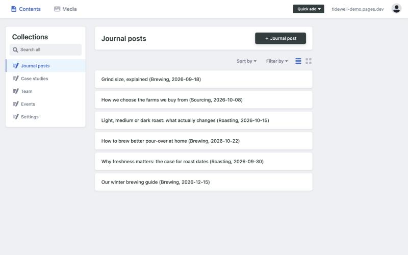
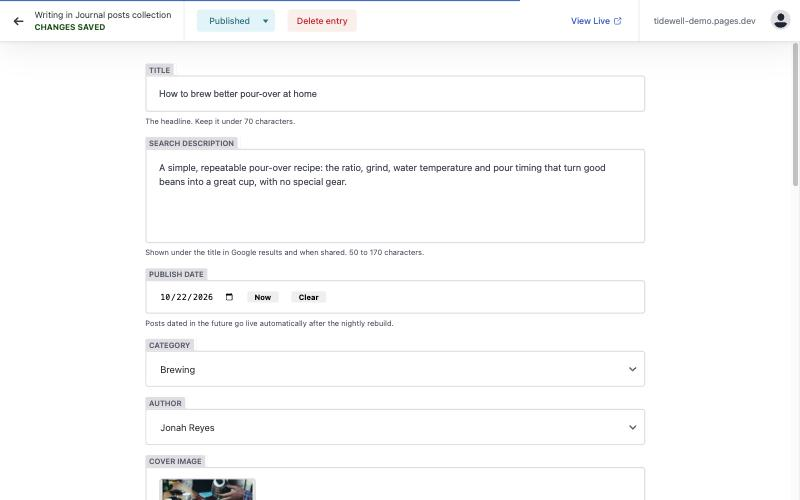
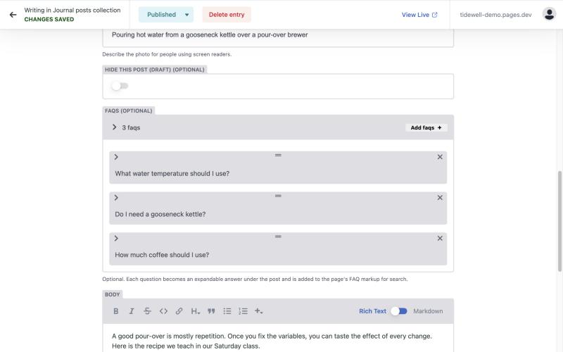
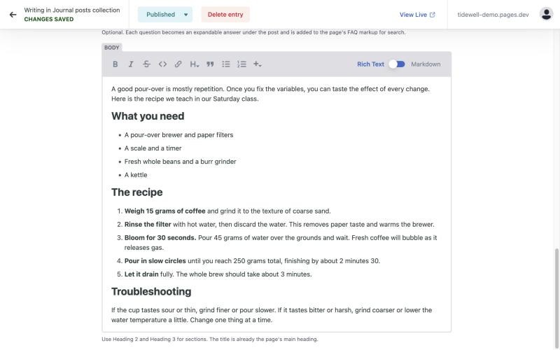
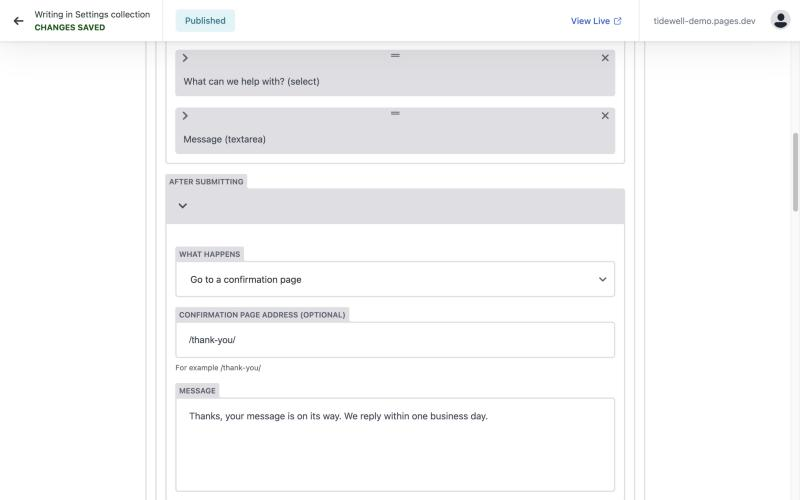

# How to publish a blog post (a guide for WordPress users)

This site does not use WordPress. Your posts are saved as simple files, and the site rebuilds itself when you publish. The editor you will use looks and works a lot like WordPress's, and this guide shows the differences.

## WordPress to this site: what is called what

| In WordPress | On this site |
|---|---|
| Dashboard / wp-admin | The **Content Manager** at `yoursite.com/admin/` |
| Posts | **Journal posts** |
| Categories | **Category** (pick one: Brewing, Roasting or Sourcing) |
| Featured image | **Cover image** |
| Yoast / SEO description | **Search description** |
| Media Library | **Media** (top bar), or upload while you edit |
| Draft, Pending review, Published | **Draft, In review, Ready, Published** |
| Schedule a post | Choose a future **Publish date** (goes live on the next nightly rebuild) |
| Revisions | Every save is kept in GitHub's history; ask us to restore an older version |
| Pages, custom post types | **Case studies, Team, Events** in the left menu |

## 1. Sign in

1. Go to **yoursite.com/admin/**.
2. Click **Login with GitHub** and sign in with the GitHub account we invited. You only do this once per browser.

You will see the Content Manager. The left menu lists everything you can edit.

## 2. Write a new post

1. Choose **Journal posts**, then click **+ Journal post** (top right).
2. Fill in the fields from top to bottom:

- **Title**: the headline. Keep it under 70 characters so it is not cut off in Google.
- **Search description**: one or two sentences that appear under your title in Google results. Between 50 and 170 characters. The editor will warn you if it is too short or long.
- **Publish date**: today, or a future date to schedule the post.
- **Category** and **Author**: choose from the lists.
- **Cover image**: click **Choose an image**, then **Upload** a landscape photo (about 1200 x 800 pixels), or pick one you uploaded before.
- **Cover image description**: describe the photo in a short sentence. This is read aloud to people who use screen readers and helps in image search.

## 3. Add questions and answers (FAQs)

FAQs help readers and AI assistants find direct answers. Click **Add faqs**, type a question and its answer, and repeat. They appear as expandable answers under your post.

## 4. Write the body

The **Body** works like the WordPress block editor in classic mode: use the toolbar for bold, italic, links, lists and quotes.

- Use **Heading 2** for main sections and **Heading 3** for sub-sections. Do not use Heading 1: your title is already the page's main heading, and a page should only have one.
- Write descriptive link text ("read our brewing guide"), not "click here".
- To add a picture inside the post, click the **+** in the toolbar and choose **Image**.
- Use the **Markdown** switch (top right of the editor) only if you are comfortable with it. Rich Text is fine.

## 5. Save, review and publish

This site uses a safe, three-step flow so nothing goes live by accident.

1. Click **Save** (top left) to keep your work as a **Draft**. You can close the window and come back later: open **Workflow** in the top bar to see everything in progress.
2. When it is ready for someone to read, change the status to **In review**.
3. When approved, change it to **Ready**, then click **Publish**, then **Publish now**.

After you publish, **wait one to two minutes**: the site is rebuilt and then your post is live. (Unlike WordPress, it is not instant.)

> **Want to see it before it goes live?** Each draft gets its own private preview web address. Open the draft, click **Check for preview**, and a link appears when it is ready.

## 6. Edit, hide or remove a post

- **Edit**: open the post, make your changes, then **Save** and publish again.
- **Hide a post without deleting it**: switch on **Hide this post (draft)**, then publish. It disappears from the site but stays in the editor.
- **Delete**: open the post and click **Delete entry**. Hide it instead if you might want it again.

## The other content types

- **Case studies**: the same steps as a post. The **Results** list becomes the big numbers on the page.
- **Team**: add a person with a photo, role and short bio. Change the **Display order** numbers to reorder the page (1 appears first).
- **Events**: set when it starts and ends (local time), the venue and the cost. Past events move to the "Past events" list on their own. Leave **Registration link** empty to send people to the contact form.
- **Settings > Contact forms**: change what the form asks, where people land after submitting, and who gets the notification email.

## Good to know

- **Scheduled posts** go live on the next nightly rebuild after their publish date, so allow up to a day.
- **Images** should be reasonably small (under 500 KB). Large camera photos slow your site down; resize them first.
- **If something looks wrong** after publishing, do not worry: nothing is lost. Hide the post and tell us, and we can roll back to the previous version.
- **Need a hand?** Email us with the link to the post and a screenshot.
